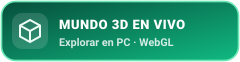
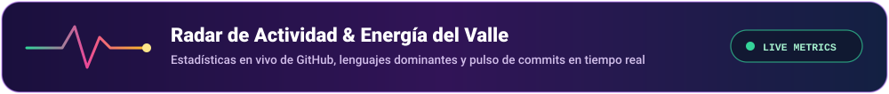
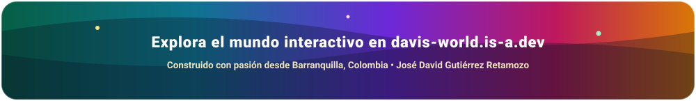

<!-- SECCIÓN 1: HERO CINEMATOGRÁFICO CON EL VIDEO 3D EN VIVO DE FONDO -->

  

 

<!-- BARRA DE ACCESOS RÁPIDOS -->

  
  
  
  

 

<!-- SECCIÓN 2: ORBE ESMERALDA — ARQUITECTURA BACKEND & DATOS -->

  

 

<!-- SECCIÓN 3: ORBE CORAL — MUNDOS 3D, WEBGL & INTERFACES VIVAS -->

  

 

<!-- SECCIÓN 4: ORBE AMATISTA — MISIONES & CONSTRUCCIONES DEL MUNDO -->

  

  
  
  
  

 

<!-- SECCIÓN 5: ORBE ÁMBAR — HABILIDADES DE EXPLORADOR (NIVEL RPG) -->

  

 

<!-- SECCIÓN 6: ORBE CIAN — CABAÑA DEL VIAJERO & CONTACTO -->

  

 

<!-- SECCIÓN 7: RADAR DE ACTIVIDAD & DIAGRAMAS EN VIVO -->

  

 

  
  

 

  

 

<!-- SECCIÓN 8: OLA MULTICOLOR ANIMADA DE CIERRE -->

  

